# LoRa Drone Control Link (ESP32 + SX1278, 433 MHz)

A digital wireless control link that sends three flight-control commands — **aileron, elevator and rudder** — from a handheld ground controller to a simulated drone over **LoRa at 433 MHz**. Built as the course project for **Digital Communication Systems (BECE306P)** at VIT Chennai.

- Two ESP32 DevKit V1 boards, each with an SX1278 (Ai-Thinker RA-02) LoRa module and a 0.96" SSD1306 OLED
- Transmitter reads a 2-axis joystick + rudder potentiometer and sends a CRC-protected 11-byte packet every 50 ms
- Receiver validates every packet in seven stages, drives three servos, and shows RSSI / SNR / packet counts / link status
- 500 ms link-loss failsafe centres all servos
- Optional half-duplex acknowledgements (every 5th packet)

📄 **Full report (IEEE format):** [docs/DCS_Project_Report_IEEE_24BEC1263.pdf](docs/DCS_Project_Report_IEEE_24BEC1263.pdf)  
📹 **Demo video:** [Google Drive](https://drive.google.com/drive/folders/17KGEKCCFoPgjZRtqW9QMCZfphlg0HTpz?usp=sharing)

> ⚠️ This is a ground-based educational prototype, **not** a flight-certified controller. Do not use it to fly a real aircraft.

---

## System overview

```
 GROUND CONTROLLER (TX)                               SIMULATED DRONE (RX)
┌──────────────────────────┐                        ┌──────────────────────────┐
│ Joystick X ─► GPIO34     │                        │            GPIO25 ─► Aileron servo
│ Joystick Y ─► GPIO35     │    LoRa 433 MHz        │            GPIO27 ─► Elevator servo
│ Rudder pot ─► GPIO32     │   SF7 · BW125 · 4/5    │            GPIO32 ─► Rudder servo
│ Button     ─► GPIO33     │ ─────── CMD ─────────► │                          │
│                          │ ◄────── ACK (1 in 5) ─ │                          │
│ ESP32 ◄SPI► SX1278 RA-02 │                        │ ESP32 ◄SPI► SX1278 RA-02 │
│ ESP32 ◄I2C► SSD1306 OLED │                        │ ESP32 ◄I2C► SSD1306 OLED │
└──────────────────────────┘                        └──────────────────────────┘
```

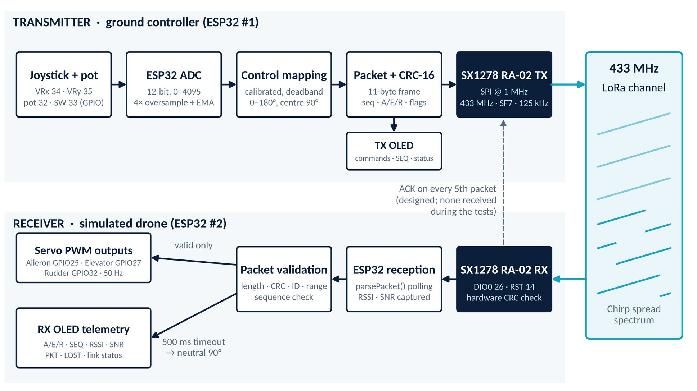

### The hardware

| Transmitter (ground controller) | Receiver (simulated drone) |
|---|---|
| 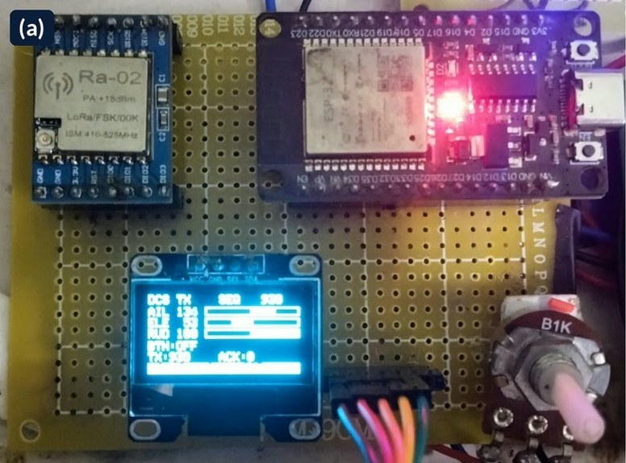 | 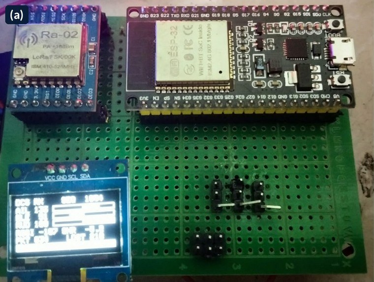 |
| 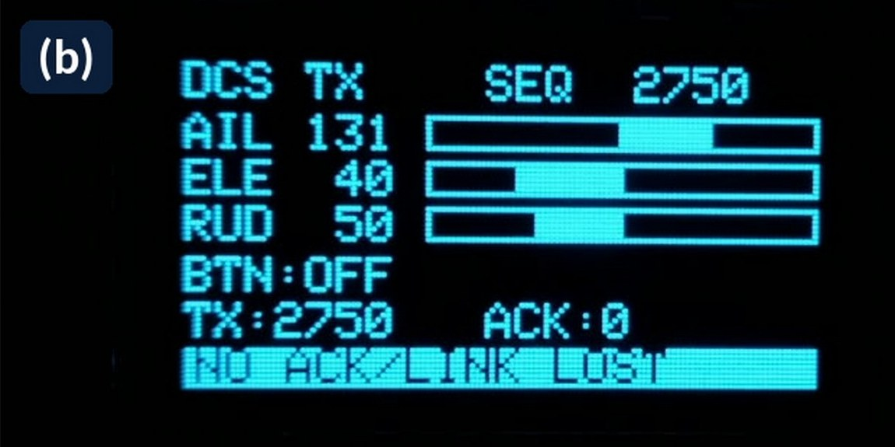 | 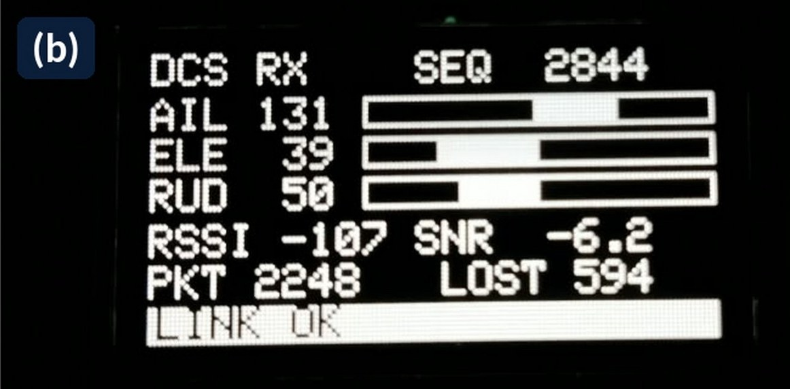 |

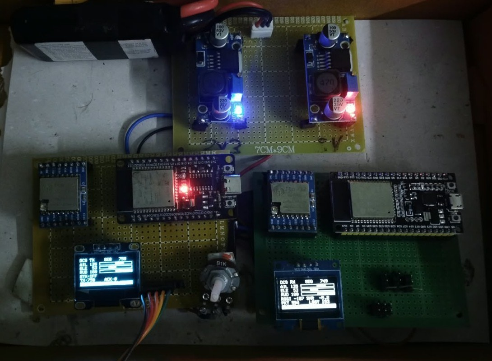
*Complete setup: battery with 3.3 V and 5 V buck converters, transmitter (left) and receiver (right).*

## Repository layout

```
firmware/
  Transmitter/Transmitter.ino   ground controller sketch
  Receiver/Receiver.ino         simulated-drone sketch
docs/
  DCS_Project_Report_IEEE_24BEC1263.pdf   full project report
  circuits/                     transmitter, receiver and power schematics
  photos/                       hardware photos
  results/                      OLED result captures and charts
```

## Hardware

| Qty | Part |
|---|---|
| 2 | ESP32 DevKit V1 (ESP32-WROOM-32) |
| 2 | SX1278 RA-02 LoRa module, 433 MHz, with antenna |
| 2 | 0.96" 128×64 SSD1306 I2C OLED (address 0x3C) |
| 1 | 2-axis analog joystick module with push-button |
| 1 | 10 kΩ potentiometer (rudder) |
| 3 | Hobby servos (SG90 / MG90S class) |
| — | Battery + 3.3 V and 5 V buck converters, jumper wires |

### Wiring — both boards

| RA-02 pin | ESP32 GPIO | | OLED pin | ESP32 GPIO |
|---|---|---|---|---|
| VCC | 3.3 V | | VCC | 3.3 V |
| GND | GND | | GND | GND |
| SCK | 18 | | SDA | 21 |
| MISO | 19 | | SCL | 22 |
| MOSI | 23 | | | |
| NSS / CS | 5 | | | |
| RESET | 14 | | | |
| DIO0 | 26 | | | |

### Transmitter inputs

| Input | ESP32 GPIO | Function |
|---|---|---|
| Joystick VRx | 34 | Aileron (roll) |
| Joystick VRy | 35 | Elevator (pitch) |
| Joystick SW | 33 | Push-button (active LOW, internal pull-up) |
| Potentiometer wiper | 32 | Rudder (yaw) |

### Receiver outputs

| Servo | ESP32 GPIO |
|---|---|
| Aileron | 25 |
| Elevator | 27 |
| Rudder | 32 |

### Circuit diagrams

| Transmitter | Receiver |
|---|---|
| 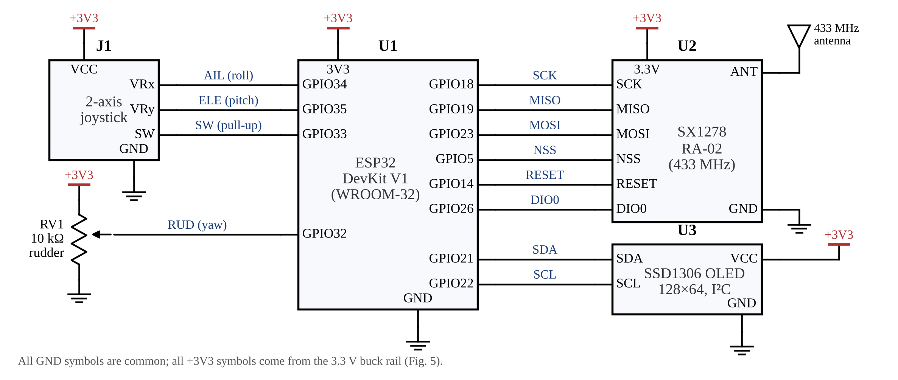 | 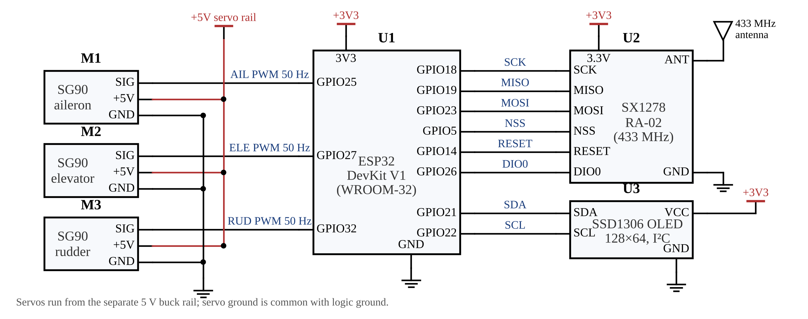 |

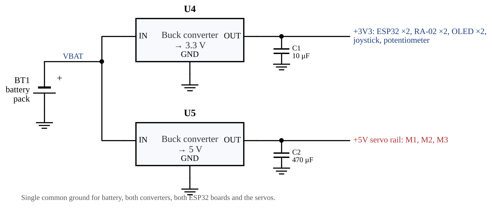

Power the servos from an external regulated **5 V** supply and tie its ground to the ESP32 ground. GPIO 26 is reserved for LoRa DIO0 — do not put a servo on it.

## Building and flashing

1. **Arduino IDE → Boards Manager:** install *esp32 by Espressif Systems* (core 2.0.x or 3.x). Board: **ESP32 Dev Module**.
2. **Library Manager:** install
   - `LoRa` by Sandeep Mistry (both boards)
   - `Adafruit SSD1306` + `Adafruit GFX` (both boards)
   - `ESP32Servo` ≥ 3.0 (receiver only — the stock `Servo` library does not support ESP32)
3. Open `firmware/Transmitter/Transmitter.ino`, upload to the controller board.
4. Open `firmware/Receiver/Receiver.ino`, upload to the drone board.
5. Open Serial Monitor at 115200 baud on either board for diagnostics.

For first bring-up, set `ENABLE_ACK = false` in `Transmitter.ino` to test the one-way link, then calibrate the joystick centre/min/max values in `calAileron`, `calElevator`, `calRudder` from the `[TX] raw …` serial lines.

## Radio configuration

Identical on both boards:

| Parameter | Value |
|---|---|
| Frequency | 433 MHz |
| Bandwidth | 125 kHz |
| Spreading factor | 7 |
| Coding rate | 4/5 |
| Sync word | 0x24 (private) |
| Preamble | 8 symbols |
| TX power | 10 dBm |
| Hardware CRC | enabled |
| Time on air (11-byte packet) | 41.2 ms |

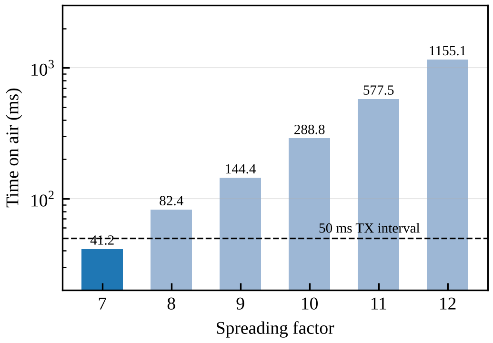

SF7 is the only spreading factor whose airtime fits inside the 50 ms command interval at 125 kHz.

## Packet format

**Command packet (TX → RX), 11 bytes, little-endian**

| Byte | Field | Value |
|---|---|---|
| 0 | Magic | `0xDC` |
| 1 | Version | `0x01` |
| 2 | Type | `0x01` = COMMAND |
| 3–4 | Sequence number | uint16, wraps at 65535 |
| 5 | Aileron | 0–180° |
| 6 | Elevator | 0–180° |
| 7 | Rudder | 0–180° |
| 8 | Flags | bit0 button, bit1 ACK request |
| 9–10 | CRC-16/CCITT-FALSE over bytes 0–8 | low byte first |

**ACK packet (RX → TX), 12 bytes:** magic, version, type `0x02`, acknowledged sequence, status bits, RSSI (int8 dBm), SNR×4 (int8), receiver valid-packet count (uint16), CRC-16.

### Receiver validation pipeline

A command reaches the servos only if it passes every stage:

1. Length is exactly 11 bytes
2. Application CRC-16 matches
3. Magic, version and type are correct
4. Reserved flag bits are zero
5. Each control value is within 0–180
6. Sequence number is newer than the last (wrap-safe; duplicates and old packets rejected, gaps counted as lost)
7. Values clamped to per-servo limits, link timer reset

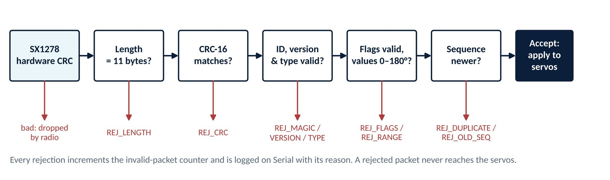

If no valid packet arrives for 500 ms, all servos go to neutral (90°) and the OLED shows **LINK LOST**.

## Results

Seven paired TX/RX readings were taken under two signal conditions (≈ −107 dBm and −68 to −77 dBm RSSI).

| Observation | Result |
|---|---|
| Command accuracy | Received values within 1° of transmitted values |
| Weakest working link | RSSI ≈ −107 dBm, SNR down to −6.2 dB (SF7 limit ≈ −7.5 dB) |
| Packet loss, strong signal | 20.0 % |
| Packet loss, weak signal | 20.6 – 20.9 % |
| ACKs received at TX | 0 |

**OLED captures** — transmitter (cyan) left, receiver (white) right:

| Set A — weak signal (≈ −107 dBm) | Set B — strong signal (−68 to −77 dBm) |
|---|---|
| 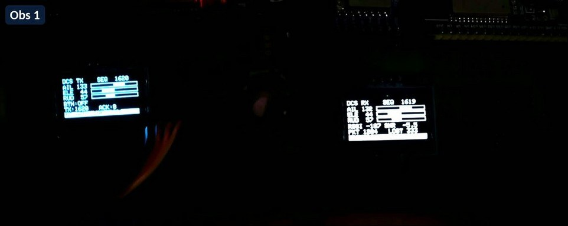 | 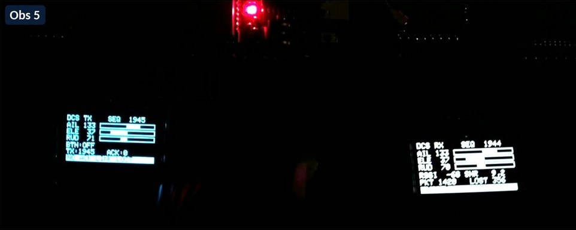 |
| 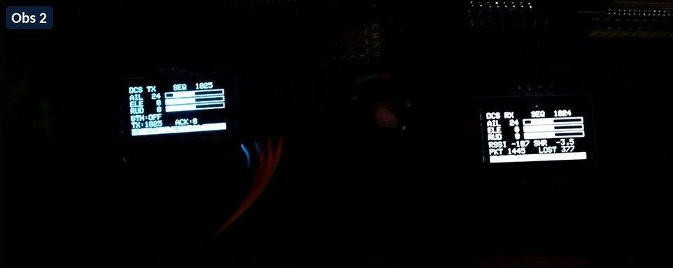 | 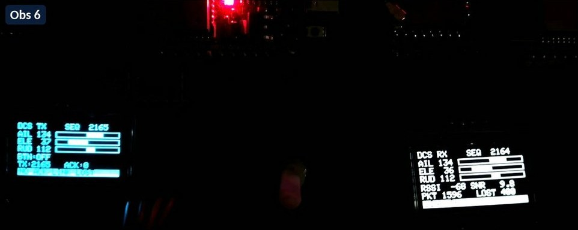 |
| 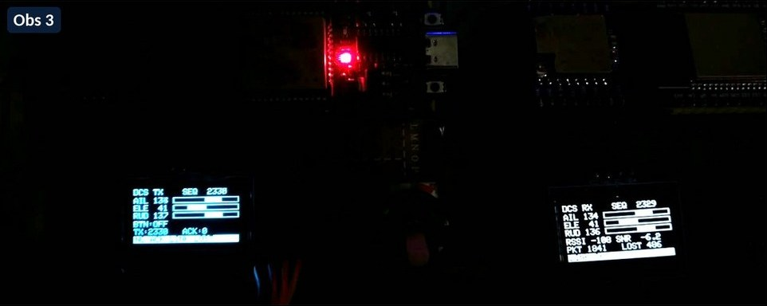 | 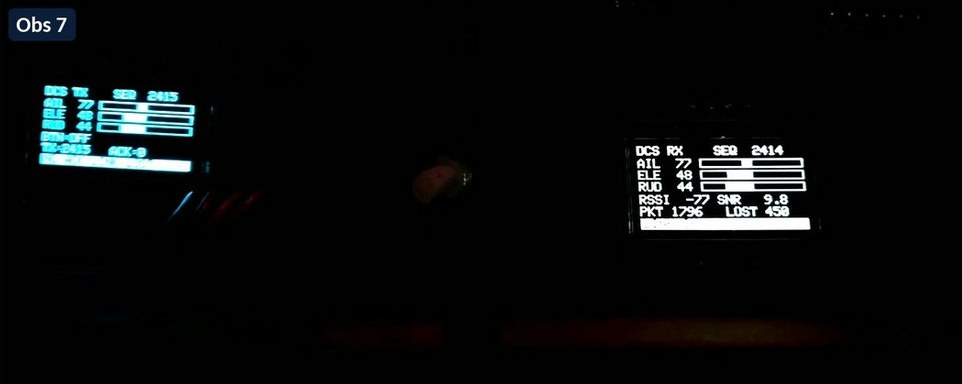 |

| RSSI & SNR per observation | Received vs transmitted command |
|---|---|
| 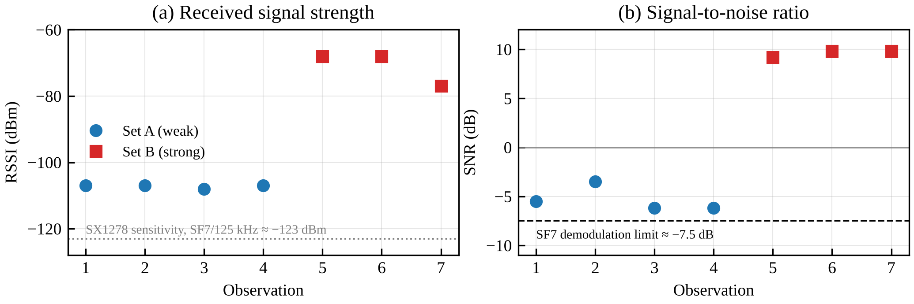 | 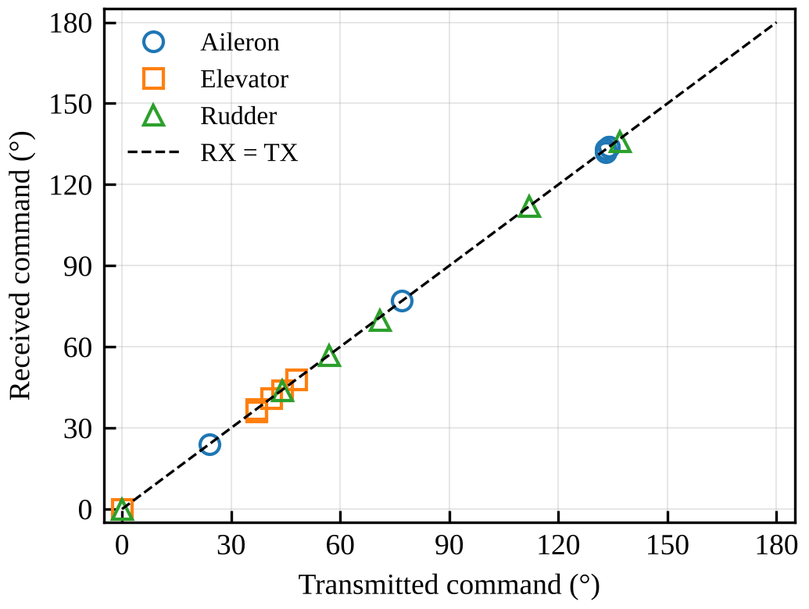 |

| Packet loss vs RSSI | Designed ACK timing |
|---|---|
| 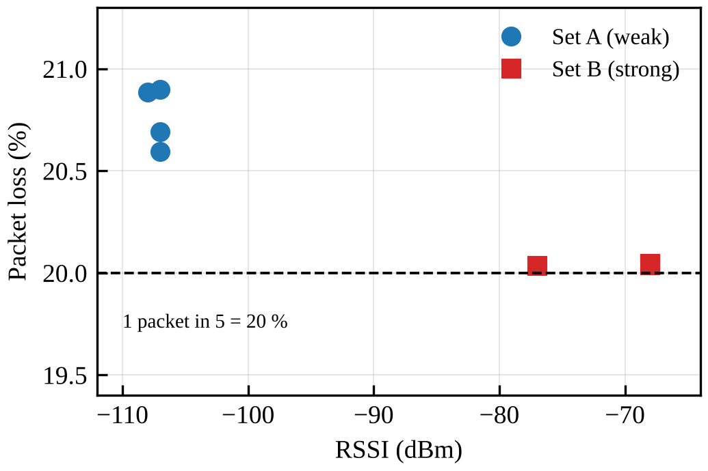 | 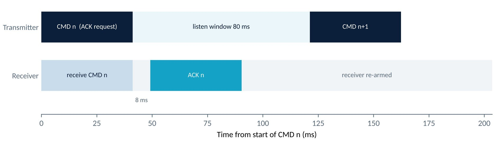 |

Packet loss stayed at almost exactly 1 in 5 across a ~35 dB change in signal strength, while the TX never received an acknowledgement. Since an ACK is requested on every 5th packet, the loss points to the **ACK exchange**, not the radio channel.

**Proposed check:** set `ENABLE_ACK = false` and repeat the strong-signal test; if loss falls to near 0 %, the ACK cycle is confirmed as the cause.

Servo actuation and failsafe timing are implemented but were not measured in this evaluation.

## Future scope

- Output CRSF / SBUS from the receiver to drive a real flight controller (as ExpressLRS and mLRS do with the same LoRa chips)
- GPS waypoint mission upload and return-to-home on link loss
- Working acknowledgements, frequency hopping, and command authentication/encryption
- Use as a long-range command link for disaster-relief scenarios where other networks are down

Any real flight must comply with India's Drone Rules, 2021 and the 433 MHz band regulations.

## Author

**V Pranav Kumar** (24BEC1263) — School of Electronics Engineering, VIT Chennai
Course: Digital Communication Systems (BECE306P) · Faculty: Dr. B. Nagajayanthi
